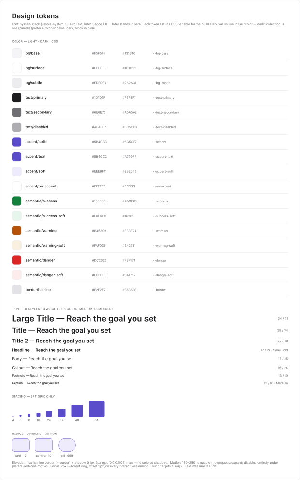

# Design

The look and behaviour of every screen. Source of truth for layout is the Figma file; this file carries everything the build needs in words, because next week the model reads this file, not a screenshot.

**Figma file:** https://www.figma.com/design/laIOka4SleP4JulAHQnG8N

Designed 2026-11-12, before the Brevo test and the interviews — see `decisions.md`. Treat the visuals as a draft until both happen; the states and rules below stand either way.

## The idea

Calm and quiet, so the one thing that matters — the risk and the next step — stands out.

- White cards on a soft gray background. Violet is the only brand color, used mainly for the one primary button per screen.
- Green, amber and red appear only when they mean something: on track, at risk / the 48-hour clock, high risk / stopped.
- Rounded cards with thin 1px borders instead of shadows.
- One screen, one message, one primary action.
- Every risk mention carries the word "estimate" (N3).
- The design uses only fields in `data-model.md` or values computed from them. It forced no new fields.

## Tokens

Copy this into the stylesheet as-is. All text/background pairs pass WCAG AA (4.5:1).

```css
:root {
  /* color */
  --bg-base: #F5F5F7;
  --bg-surface: #FFFFFF;
  --bg-subtle: #EDEDF0;
  --bg-pressed: #E4E4E9;
  --text-primary: #1D1D1F;
  --text-secondary: #6E6E73;
  --text-disabled: #AEAEB2;     /* decorative only, never for real text */
  --accent: #5B4CCC;
  --accent-hover: #4F42B5;
  --accent-pressed: #443997;
  --accent-text: #5B4CCC;
  --accent-soft: #EEEBFC;
  --on-accent: #FFFFFF;
  --success: #15803D;
  --success-soft: #E6F6EC;
  --warning: #B45309;
  --warning-soft: #FAF0DF;
  --danger: #DC2626;
  --danger-soft: #FCECEC;
  --border: #E2E2E7;

  /* spacing — 8pt grid only */
  --space-4: 4px;  --space-8: 8px;   --space-12: 12px; --space-16: 16px;
  --space-24: 24px; --space-32: 32px; --space-48: 48px; --space-64: 64px;

  /* radius */
  --radius-card: 12px;
  --radius-control: 10px;
  --radius-pill: 999px;

  /* type */
  --font: -apple-system, BlinkMacSystemFont, "SF Pro Text", "Inter", "Segoe UI", sans-serif;
}

@media (prefers-color-scheme: dark) {
  :root {
    --bg-base: #131316;
    --bg-surface: #1D1D22;
    --bg-subtle: #2A2A31;
    --bg-pressed: #33333B;
    --text-primary: #F5F5F7;
    --text-secondary: #A5A5AE;
    --text-disabled: #5C5C66;
    --accent: #6C5CE7;
    --accent-hover: #7E70EA;
    --accent-pressed: #8F83EE;
    --accent-text: #A799FF;
    --accent-soft: #2B2546;
    --success: #4ADE80;
    --success-soft: #16301F;
    --warning: #FBBF24;
    --warning-soft: #342711;
    --danger: #F87171;
    --danger-soft: #3A1717;
    --border: #36363E;
  }
}
```

## Type scale

Figma uses Inter as the stand-in for the system stack. Three weights only: Regular, Medium, Semi Bold.

| Style | Size / line | Weight | Used for |
|---|---|---|---|
| Large Title | 34 / 41 | Semi Bold | Screen-level moments only |
| Title | 28 / 34 | Semi Bold | Screen headings |
| Title 2 | 22 / 28 | Semi Bold | Card headlines, key numbers |
| Headline | 17 / 24 | Semi Bold | Buttons, emphasized rows |
| Body | 17 / 25 | Regular | Default reading text |
| Callout | 16 / 24 | Regular | Secondary reading text, inputs |
| Footnote | 13 / 19 | Regular | Helper text, the estimate disclaimer |
| Caption | 12 / 16 | Medium | Labels, pills, timestamps |

## Rules

- Elevation: 1px `--border` line; at most `0 1px 2px rgba(0,0,0,0.04)`. No colored shadows.
- Motion: 150–250ms ease on hover/press/expand; none under `prefers-reduced-motion`.
- Focus: 2px `--accent` ring, offset 2px, on every interactive element.
- Touch targets at least 44px. Text measure at most 65ch.
- Icons are inline stroke SVG (2px, round caps), never emoji.
- Error messages: a plain sentence under the field or in place of the content, in `--danger`, saying what failed and what to do next — never a raw error (`rules.md`).

## Components (in Figma)

Button (Primary / Secondary / Tertiary × Default / Hover / Pressed / Disabled / Focus), Input (Default / Focus / Filled / Error / Disabled), Task Row (To do / Done), Badge (Neutral / Accent / Success / Warning / Danger), and 14 stroke icons.


## Shared states

Two patterns every screen reuses, instead of inventing its own:

- **Loading.** Centered violet logo tile, a spinning arc in `--accent` (still under `prefers-reduced-motion`), "Loading…" in Callout, and the Footnote "The first visit can take up to a minute while the free server wakes up" — because Render's free tier sleeps (`stack.md`). Used whenever a whole screen waits; a single action that waits (a save, a send) instead disables its button and swaps its label to "…ing" with the spinner.
- **Error.** Centered warning icon in a `--danger-soft` circle, "Something went wrong" in Title 2, a plain sentence naming what failed and that nothing is lost, a "Try again" primary button, and the Footnote about the free server waking up. A failed field-level action shows the Input error state instead, with its sentence under the field.

## Screens — all four states, every screen

Five screens (`screens.md`, A14). The extra dashboard frames in Figma are states of S4, not new screens.

### S1 · Sign up / Log in — serves R1, N8

**On it:** logo, app name, tagline; a Sign up / Log in segmented control; Name (sign-up only), Email, Password inputs; a footnote that the timezone is read from the browser (A19); primary button; "Forgot your password?" tertiary link, which swaps the card to an email field + "Send reset link", and from the emailed link to a new-password field.

- **Empty:** the form itself is the empty state — blank fields with placeholder text, Sign up tab active. This is the first thing every new user sees.
- **Loading:** on submit, the button disables and reads "Creating account…" / "Logging in…" with the small spinner; fields lock.
- **Error:** a plain sentence under the failing field: "That email and password didn't match. Try again or reset your password." The reset request always answers "If that account exists, the email is on its way" — it never reveals whether an account exists (R1).
- **Full:** valid session → straight to S4. A logged-in learner who opens S1 is redirected to S4.

### S2 · Goal — serves R2, R8, R13, N11

**On it:** "Set your goal" heading; Goal input; Exam date / Self-set selector; Deadline input; optional career note with the footnote "Only used for AI suggestions. Never shared" (N9); a chosen-person card — explainer ("they get an email when you go 48 hours without finishing a task; your goal starts only after they confirm"), their name + email inputs, and the screen's primary button, "Send confirmation request".

- **Empty:** blank form, Exam date preselected. Reached on day one from the dashboard's empty state, or via "Start a new goal" after an outcome.
- **Loading:** "Send confirmation request" disables to "Sending…". Saving edits to a waiting goal shows "Saving…".
- **Error:** naming your own account address → "Your chosen person can't be you — pick someone who'll notice" (R8). Request with zero tasks → the button stays disabled with the footnote "Add at least one task first" linking to S3 (R8). A failed send → "The email didn't go out. Nothing was lost — try again."
- **Full:** a waiting goal shows the saved values, editable, with Abandon as a tertiary action (R13). After the goal starts: deadline and target read-only (N11); the chosen person is replaceable only if they stopped (R8).

### S3 · Tasks — serves R3, R8

**On it:** "Break it into daily tasks" heading; the goal + deadline chip; an add-task field with a 48px "+" button; the ordered task list (checkbox, title, drag handle); the footnote "Tasks can be deleted only before the goal starts"; "Continue" primary.

- **Empty:** a card with a plus icon in a circle, "No tasks yet", and "Add the first small step — something you can finish today. Your goal needs at least one task before the confirmation request can go out" (R8). Continue disabled.
- **Loading:** list area shows three gray skeleton rows on first load; adding a task disables the "+" while saving.
- **Error:** a failed add keeps the typed text in the field and shows "That didn't save. Try again." Deleting after the start, or the last task while a request is out, is refused with "Tasks are locked once the goal starts — that's the deal" / "The request Sara got promised at least one task" (R3, R8).
- **Full:** done rows (green check, struck-through, gray) above-or-among to-do rows in the learner's order; reorder by drag; ticking happens on S4, not here.

### S4 · Dashboard — serves R4, R5, R6, R7, R8, R10, R12, R13, N3, N7

**On it (full/active):** greeting + goal + days-left header; status card — risk badge (On track `--success` / At risk `--warning` / High risk `--danger`) always next to "Estimate, not a prediction" (N3), "N tasks behind plan" in Title 2, Planned-by-today bar (violet) and Done bar (green) with counts (R5, R6); 48-hour clock card — "Last task done N h ago", hours-left badge, amber progress toward 48h, "At 48 hours with no task done, an email goes to you and Sara" (R9); next-step card — the next unticked task or the learner's pick (R7), with the screen's one primary button "Mark as done" (R4; the last task asks "This completes your goal — sure?" per R13); AI suggestion card with "Add as a task" tertiary (R12 — if AI fails, the card simply shows the next unticked task and nothing breaks); chosen-person row with status badge (Confirmed / Pending / Stopped).

- **Empty:** no goal at all (new account, or the old goal is finished and replaced) → a single card: "No goal yet. One goal, a real deadline, someone who'll notice." with "Set your goal" primary leading to S2.
- **Loading:** skeleton: gray header bar plus three gray card outlines, with the shared loading note if it's the first hit of the day (server wake-up).
- **Error:** the shared error state — "We couldn't load your goal. Nothing is lost — your tasks and the 48-hour clock are safe on the server." + Try again.
- **Full** — five sub-states, all designed in Figma:
  - **Waiting** (R8, A20): "Waiting for Sara to confirm" with a Pending badge, note that tasks can be written but not ticked and that the clock starts on confirmation, and "Choose someone else" secondary.
  - **Active:** as described above.
  - **Person stopped** (N7, R9): a danger banner "Sara stopped emails — until someone else confirms, warnings go only to you", with "Choose someone else"; the chosen-person row shows a Stopped badge.
  - **Completed** (R10, R13): green check, "Goal completed", final count "30 of 30 tasks", "Start a new goal" primary. No email is sent (decision).
  - **Ended** (R10, R13): flag icon, "Deadline passed", the date, final count, note that both people got one final email, "Start a new goal" primary.

### S5 · Chosen person page — serves R8, N1, N6, N7

Opened from an email link, no login. **On it:** "Leen picked you" heading; what this is, in two sentences; the goal card (name + deadline — the request states the deadline so they agree knowing it, R8); a "What you'll get" list (an email only after 48 quiet hours; the goal name, delay and risk estimate, never task details — N6; one final email if the deadline is missed); "Confirm — I'm in" primary; "Stop all emails about this goal" in `--danger`; footnote "every email has a stop link" (N7).

- **Empty (invalid link):** an ended or abandoned goal, or a replaced pending person → "This link isn't active anymore. Nothing more will be sent to you." No buttons (R13: a confirm link on an ended goal is refused).
- **Loading:** the shared loading state while the link is checked.
- **Error:** "That didn't go through. Your answer wasn't recorded — try the link again."
- **Full:** the request as above; after confirming → "You're in" (green check) with when they'll hear from us; after stopping → "Emails stopped" with "Leen can see that you stopped and may choose someone else."

## Emails (not screens, for completeness)

Five, wording in one place (`rules.md`): confirmation request (deadline included, R8), no-task warning to the learner, no-task warning to the chosen person (N6 fields only, stop link, "estimate", N3/N7), missed-deadline email (R13), password reset (R1). Email layout: plain, the app's name, one sentence of fact, one link.



