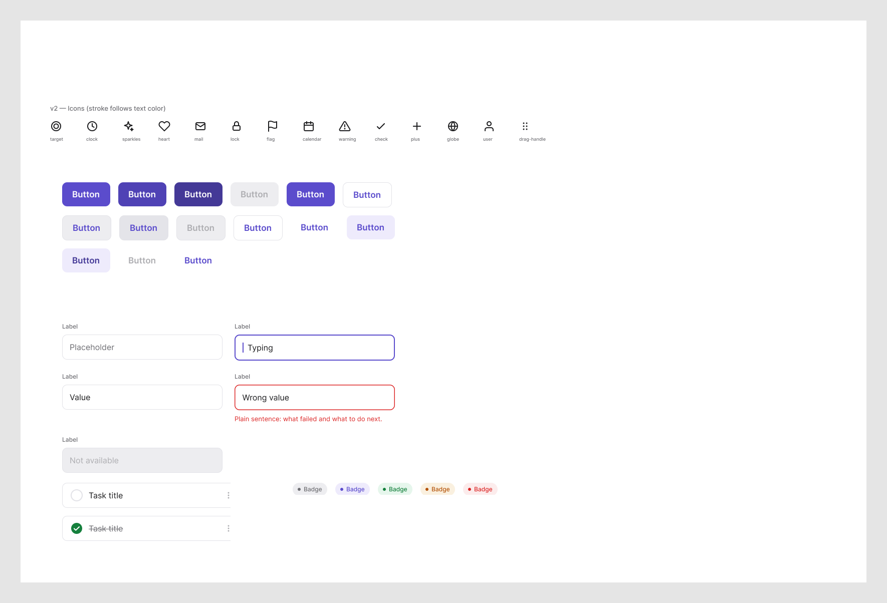
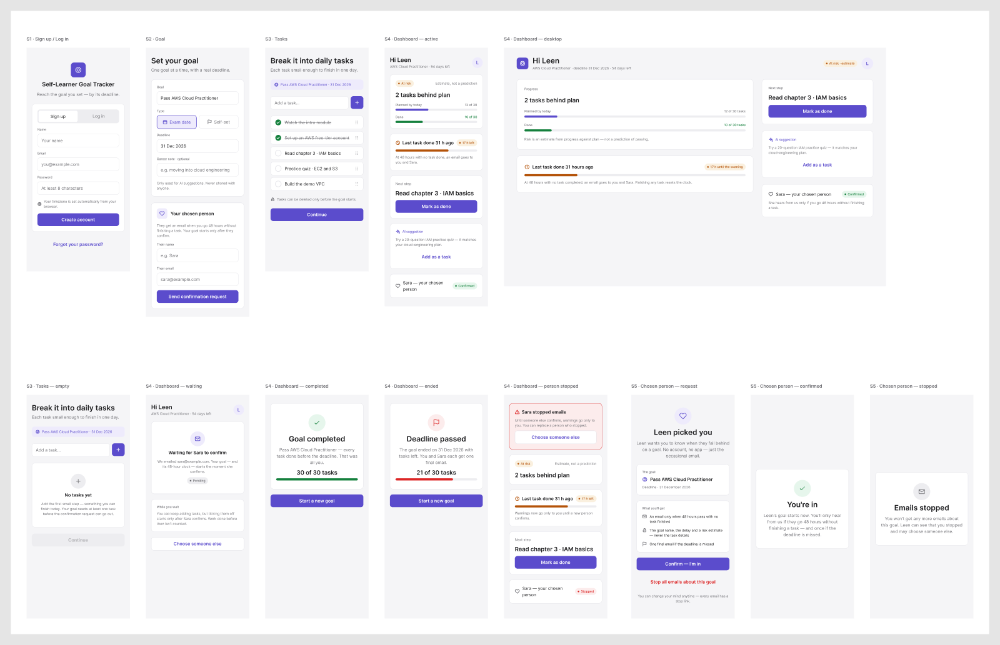

# Design

The look of the app. Source of truth is the Figma file; this file carries everything the build needs, so no code has to be read off a picture.

**Figma file:** https://www.figma.com/design/laIOka4SleP4JulAHQnG8N

Designed 2026-11-12, before the Brevo test and the interviews — see `decisions.md`. Treat the screens as a draft until both happen.

## The idea

Calm and quiet, so the one thing that matters — the risk and the next step — stands out.

- White cards on a soft gray background. Violet is the only brand color, used mainly for the one primary button per screen.
- Green, amber and red appear only when they mean something: on track, at risk / the 48-hour clock, high risk / stopped.
- Rounded cards with thin 1px borders instead of shadows.
- One screen, one message, one primary action.
- Every risk mention carries the word "estimate" (N3).

## Tokens

Copy this into the stylesheet as-is. All text/background pairs pass WCAG AA (4.5:1).

```css
:root {
  /* color */
  --bg-base: #F5F5F7;
  --bg-surface: #FFFFFF;
  --bg-subtle: #EDEDF0;
  --bg-pressed: #E4E4E9;
  --text-primary: #1D1D1F;
  --text-secondary: #6E6E73;
  --text-disabled: #AEAEB2;     /* decorative only, never for real text */
  --accent: #5B4CCC;
  --accent-hover: #4F42B5;
  --accent-pressed: #443997;
  --accent-text: #5B4CCC;
  --accent-soft: #EEEBFC;
  --on-accent: #FFFFFF;
  --success: #15803D;
  --success-soft: #E6F6EC;
  --warning: #B45309;
  --warning-soft: #FAF0DF;
  --danger: #DC2626;
  --danger-soft: #FCECEC;
  --border: #E2E2E7;

  /* spacing — 8pt grid only */
  --space-4: 4px;  --space-8: 8px;   --space-12: 12px; --space-16: 16px;
  --space-24: 24px; --space-32: 32px; --space-48: 48px; --space-64: 64px;

  /* radius */
  --radius-card: 12px;
  --radius-control: 10px;
  --radius-pill: 999px;

  /* type */
  --font: -apple-system, BlinkMacSystemFont, "SF Pro Text", "Inter", "Segoe UI", sans-serif;
}

@media (prefers-color-scheme: dark) {
  :root {
    --bg-base: #131316;
    --bg-surface: #1D1D22;
    --bg-subtle: #2A2A31;
    --bg-pressed: #33333B;
    --text-primary: #F5F5F7;
    --text-secondary: #A5A5AE;
    --text-disabled: #5C5C66;
    --accent: #6C5CE7;
    --accent-hover: #7E70EA;
    --accent-pressed: #8F83EE;
    --accent-text: #A799FF;
    --accent-soft: #2B2546;
    --success: #4ADE80;
    --success-soft: #16301F;
    --warning: #FBBF24;
    --warning-soft: #342711;
    --danger: #F87171;
    --danger-soft: #3A1717;
    --border: #36363E;
  }
}
```

## Type scale

Figma uses Inter as the stand-in for the system stack. Three weights only: Regular, Medium, Semi Bold.

| Style | Size / line | Weight | Used for |
|---|---|---|---|
| Large Title | 34 / 41 | Semi Bold | Screen-level moments only |
| Title | 28 / 34 | Semi Bold | Screen headings |
| Title 2 | 22 / 28 | Semi Bold | Card headlines, key numbers |
| Headline | 17 / 24 | Semi Bold | Buttons, emphasized rows |
| Body | 17 / 25 | Regular | Default reading text |
| Callout | 16 / 24 | Regular | Secondary reading text, inputs |
| Footnote | 13 / 19 | Regular | Helper text, the estimate disclaimer |
| Caption | 12 / 16 | Medium | Labels, pills, timestamps |

## Rules

- Elevation: 1px `--border` line; at most `0 1px 2px rgba(0,0,0,0.04)`. No colored shadows.
- Motion: 150–250ms ease on hover/press/expand; none under `prefers-reduced-motion`.
- Focus: 2px `--accent` ring, offset 2px, on every interactive element.
- Touch targets at least 44px. Text measure at most 65ch.
- Error messages: a plain sentence under the field in `--danger` — never a raw error (`rules.md`).

## Components (in Figma)

Button (Primary / Secondary / Tertiary × Default / Hover / Pressed / Disabled / Focus), Input (Default / Focus / Filled / Error / Disabled), Task Row (To do / Done), Badge (Neutral / Accent / Success / Warning / Danger), and 14 stroke icons that replace all emoji.



## Screens

The five screens from `screens.md`, plus every state the requirements demand — states of those five, not new screens (A14 still holds).

| Frame | State of | Serves |
|---|---|---|
| S1 Sign up / Log in | S1 | R1, N8 |
| S2 Goal | S2 | R2, R8, R13, N11 |
| S3 Tasks · S3 empty | S3 | R3, R8 |
| S4 Dashboard active | S4 | R4–R7, R10, R12, N3 |
| S4 waiting | S4 | R8, A20 |
| S4 completed · S4 ended | S4 | R10, R13 |
| S4 person stopped | S4 | N7, R9 |
| S4 desktop | S4 | R10 (desktop browser) |
| S5 request · confirmed · stopped | S5 | R8, N1, N6, N7 |




